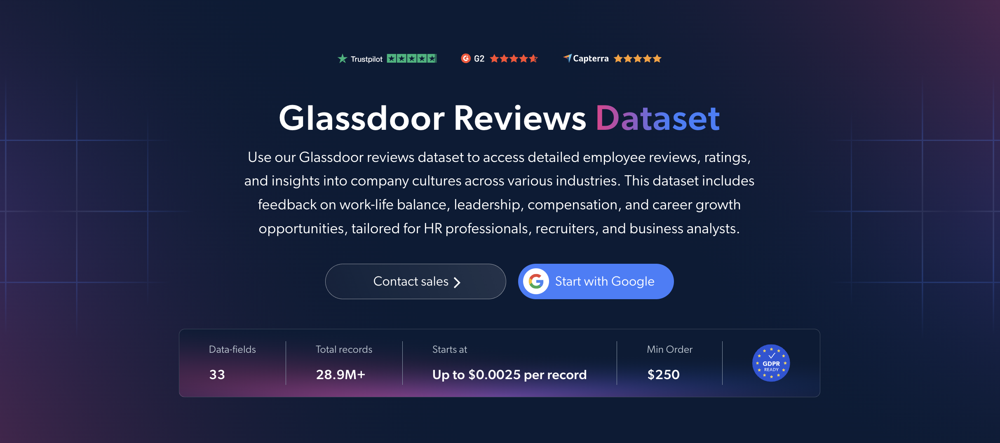

# Glassdoor-Reviews-dataset-samples

<h2>A sample dataset of 1000 Glassdoor company reviews</h2>

<a href="https://brightdata.com/products/datasets/glassdoor/reviews">
   
</a>

A Glassdoor reviews dataset sample of 1000 employee reviews of companies. Dataset was extracted using the <b>Bright Data API</b>.

<h2>Some of the data points that are included in the dataset:</h2>

* ```review_id```: Unique identifier for each review
* ```review_url```: URL of the review on Glassdoor
* ```company_name```: Name of the reviewed company
* ```rating_date```: Date the review was submitted
* ```summary```: Summary of the review
* ```review_pros```: Positive aspects mentioned in the review
* ```review_cons```: Negative aspects mentioned in the review
* ```advice_to_management```: Reviewer's advice to the company's management
* ```rating_overall```: Overall rating given by the reviewer
* ```rating_work_life```: Rating for work-life balance
* ```rating_culture_values```: Rating for culture and values
* ```rating_diversity_inclusion```: Rating for diversity and inclusion
* ```rating_compensation_benefits```: Rating for compensation and benefits
* ```rating_senior_leadership```: Rating for senior leadership
* ```rating_career_opportunities```: Rating for career opportunities
* ```flags_business_outlook```: Reviewer's outlook on the company's business
* ```flags_ceo_approval```: Whether the reviewer approves of the CEO
* ```flags_recommend_frend```: Whether the reviewer would recommend the company to a friend
* ```employee_job_title```: Job title of the reviewer
* ```employee_status```: Employment status of the reviewer, such as full-time or part-time
* ```employee_type```: Whether the reviewer is a current or former employee
* ```employee_length```: How long the reviewer worked at the company

And a lot more.

This is a sample subset which is derived from the "Glassdoor Companies Reviews (public data)"
dataset which includes more than <b>28,900,000 reviews</b>.

Available dataset file formats: <b>JSON, NDJSON, JSON Lines, CSV, or Parquet. Optionally, files can be compressed to .gz</b>.

Dataset delivery type options: <b>Email, API download, Webhook, Amazon S3, Google Cloud storage, Google Cloud PubSub, Microsoft Azure, Snowflake, SFTP</b>.

Update frequency: <b>Once, Daily, Weekly, Monthly, Quarterly, Biannual, or Custom basis</b>.

Data enrichment available as an addition to the data points extracted: <b>Based on request.</b>

<b>[Get the full Glassdoor Reviews dataset](https://brightdata.com/products/datasets/glassdoor/reviews)</b>.

<a href="https://brightdata.com/products/datasets/glassdoor/reviews">
</a>

<h2>What are the Glassdoor Reviews datasets use cases?</h2>

<h3>1. Business intelligence and competitor insights</h3>
Companies use Glassdoor reviews datasets to analyze employee ratings, pros and cons for themselves and their competitors. Comparing ratings for culture, compensation and leadership shows where competitors are strong, where they struggle, and what drives people to stay or leave, helping companies win talent.

<h3>2. Investment research</h3>
Investors track employees' business outlook and CEO approval over time to spot companies on the rise or in decline. Shifts in employee sentiment often appear before they show up in financial results, making this data a useful early signal.

<h3>3. Employer brand improvement</h3>
HR teams read advice to management by job title and employee status to find the issues current and former employees raise most. This helps prioritize improvements to culture, benefits and leadership, and track whether those changes improve ratings over time.

<h2>Free access to web scraping tools and datasets for academic researchers and NGOs</h2>

The Bright Initiative offers access to Bright Data's <b>[Web Scraper APIs](https://brightdata.com/products/web-scraper)</b> and <b>[ready-to-use datasets](https://brightdata.com/products/datasets)</b> to leading academic faculties and researchers, NGOs and NPOs promoting various environmental and social causes. You can submit an application <b>[here](https://brightinitiative.com)</b>.
